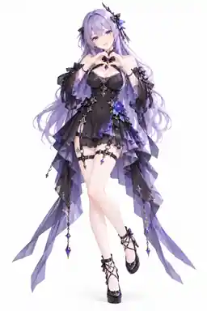

# 全身 05 · 胸前双手比心／甜美开心笑容 — 通用 Pose 参考

> 这张图是用户审核通过的**动作和镜头视觉参考**，不是可以直接导入的 MMD/VPD 姿势文件，也不是 AniForge 的真实 Blender 渲染结果。图片中的人物、发型、裙装、材质、饰品和鞋子仅为示意；插件须保留实际角色的原始外观，适配多种骨架与服装。

## 已确认的设计

| 项目 | 规范 |
| --- | --- |
| 分组 / 编号 | **全身 05**；四视图 01–04 后的第 1 张特色全身 Pose |
| 核心 Pose | **双手在胸前共同组成一个完整爱心**。两手拇指及食指自然弯曲并靠近，避免手指相互穿透；不做单手比心 |
| 另一处动作 | **腿部重心变化**：重心主要在一条腿，另一只脚稍向前摆放，脚尖轻点地，形成温柔、自然的交错站姿 |
| 躯干 / 肩 | 自然直立，腰部允许极轻微侧倾；肩膀放松，不耸肩，不大幅扭腰 |
| 头部 | 略微歪头约 **5°–10°**，眼神看镜头，不夸张抬头或低头 |
| 表情 | **甜美开心的笑容**，双眼自然睁开，嘴角明显上扬，允许轻微露齿或微张嘴（取决于模型真实表情形态键） |
| 相机 | **正前方 0°，自然平视**。使用中焦透视或适度正交取景，避免广角使手掌和鞋子变形 |
| 画幅 / 背景 | **2:3 竖幅；纯白背景 #FFFFFF** |
| 构图范围 | **角色从最高头饰到鞋底完整入镜**，包括散开的长发、裙摆、悬挂饰品、两只手和脚尖，留出边缘安全空间 |
| 输出策略 | 左右脚可作为镜像候选，但同一特色镜头正式只输出 **1 张** |

## 与其他镜头的差异

- **全身 01–04**：同一中性自然站姿，从前、左、右、后四个方向记录体型、服装结构和鞋靴。
- **全身 05**：前景依然看全身，但通过**胸前比心手势、腿部重心偏移与轻点地的脚步**记录非标准站姿，不是单纯把半身手势扩大成全身画幅。
- **半身 06**：单手朝镜头比耶；**全身 05** 是双手爱心，不重复手型或情绪动作。
- **全身 06–12**：尚未逐张确定，不能据此推定已实现的 Pose 编排。

## 面向多模型的实现与兼容要求

1. **双手协同目标**：依据骨架肩、肘、腕、手掌和指骨的长度、局部轴向计算左右手目标。让两手在胸前形成稳定爱心轮廓，保持手部相对独立，避免指尖或手掌穿模，不固定示例角色的手臂长度与坐标。
2. **不同手部骨架兼容**：如模型缺少完整指骨、骨骼命名不同或手型受手套限制，优先做可识别的近似双手爱心；必要时允许手动调整，避免虚构已完成的精确手指控制。
3. **双腿与平衡**：通过足底、脚踝、膝盖、骨盆及重心约束，让主要支撑脚稳定贴地，另一只脚轻点地；不强制使裙摆、长靴或高跟鞋产生不自然变形。左右脚可镜像选择。
4. **保留真实衣装**：不同 MMD 模型原有服装、披风、裙摆、武器、发型和配件应保持不变；不能为了匹配参考图改变服装样式。爱心手势尽量不遮住整张脸和最关键的服装识别区域。
5. **镜头动态适配（未来目标）**：在姿势应用后计算最高头饰、发梢、裙摆、手肘、指尖和鞋底的最终投影范围，调整距离/相机尺度，确保全部结构完整入镜，统一 2:3 竖幅。
6. **表情映射回退**：优先使用现有模型的自然笑容/开心形态键，不存在时退回支持的微笑或中性脸；记录实际成功映射结果。
7. **质量验收**：至少检查手指是否形成可辨识心形、左右手与胸饰/领口不严重穿模、支撑脚不悬空、另一只脚尖合理落地、裙摆和长发自然、鞋子及头饰完整入镜。

## 本 PR 的实施范围

**只新增这份设计文档及一张已经审核的白底 Pose 缩略参考图。** 不修改现有 AniForge 插件的 Pose 生成、全身镜头数量或 Blender 渲染逻辑；全身组拟采用 **四视图 4 张 + 不同动作 8 张 = 12 张**，具体实现与真实模型测试待整组确认后再处理。
