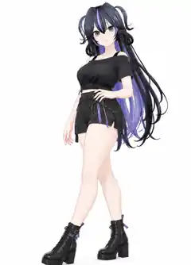

# 全身 06 · 微侧身交错站姿 / 一手扶腰 — 通用 Pose 参考

> **参考图来自本次确认的用户图片，仅用于 Pose / 镜头审核。** 图片中人物、发型、服装和鞋子不是 AniForge 的固定角色模板，不能据此改变其他 MMD 模型原有外观；此处不是可导入的 MMD/VPD 姿势，也不代表已完成 Blender 实测。仓库保存的是原图的压缩预览版。

## 已确认规格

| 项目 | 设计 |
| --- | --- |
| 归属 | **全身 06**（标准四视图 01–04 后的特色全身动作之一） |
| Pose 主题 | **微侧身、交错站姿、一腿斜向前伸**；不是行走过程中的抓拍，也不是奔跑动作 |
| 腿部 | 重心以一条腿稳定支撑，另一条腿向身前斜伸形成柔和交错线条；膝盖自然放松，双足按鞋型合理落地 |
| 脚部 | 按用户选定参考图保留完整鞋靴，**不强制脚尖点地**；尤其是厚底靴、高跟鞋可采用自然的鞋底接地 |
| 手臂 | **一手轻放腰侧，另一手自然垂放**，手指松弛；支持左右镜像 |
| 躯干 | 身体略微向一侧转动，腰臀线条自然，避免夸张后仰、扭腰或过度交叉造成不稳 |
| 表情与头 | 自然浅笑、目光朝镜头；头部略微转回相机，不仰头、不强烈歪头 |
| 水平镜头 | **左前或右前 25°–35°**，按模型/动作的遮挡情况选择；镜头基本平视，不使用夸张广角和强烈仰拍 |
| **画幅** | **2:3 竖屏**，本动作明确不使用横屏 |
| 背景 | **纯白 #FFFFFF**，简洁柔和照明，无文字、其他人物和场景道具 |
| 取景 | 最高头饰至鞋底全部入画；重心放在**腰、腿部服饰、袜子与鞋靴**，但绝不裁切脸和双脚 |
| 输出 | 最终只生成 1 张，左右镜像不额外增加数量 |

## 为什么采用竖屏

本动作属于**站立型全身照**，人物高度显著大于横向跨度。使用 2:3 竖屏可以提高人物占画面比例，尤其保留腿与鞋的可观察细节。此前生成的横屏版本留白过多，不适合作为全身 06 的最终构图。

**横屏不是被取消，而是按 Pose 类型选择：** 对下蹲、鸭子坐、坐姿、跪坐、盘腿、侧向展开等横向跨度更大的动作，后续可选择 4:3 或 16:9 横屏。画幅**不应被所有全身 Pose 统一锁死为一种比例**，需要根据姿势最终的 2D 投影边界与服装范围选择适当的画幅。

## 通用 MMD 模型适配原则

1. **不绑定某个模型**：根据实际骨架的髋、膝、踝、脚掌、肩、肘、手腕骨骼映射姿势。尽量保留角色原始服装、体型、鞋靴和发型。
2. **支撑脚稳定**：优先让承重脚接地，前伸脚按照其鞋底、鞋跟结构自然落地；厚底鞋、长靴、高跟鞋不能强行使用同一个脚尖旋转角度。
3. **腿部交错可调**：依据腿长、裙摆、披风以及膝盖活动范围调整交错距离。避免两腿穿模、脚底悬空或重心失衡；如果严重不适合该模型，回退为更自然的分腿斜站姿。
4. **手部与服装兼容**：手放腰侧时不压坏裙摆/腰带/挂件；对于宽袖、重装、护甲允许微调手肘位置，另一手自然松弛。
5. **动态取景为目标而非既有能力**：在应用最终 Pose 后考虑头发、头饰、手、裙摆、武器挂件以及鞋底等边界，按该镜头的竖屏裁切和安全留白自动或手动调整相机距离。
6. **展示下半身但保留完整全身**：校验腿部袜饰、膝部配件、鞋跟、鞋尖是否清晰可辨，避免仅把人物缩得很小而保留大量空白。
7. **表情与动作回退**：若模型没有自然浅笑对应形态键，使用现有最接近表情并记录实际应用结果；不声称自动纠错、碰撞检测和适配已实现。

## 已确定镜头对比

| 编号 | Pose | 画幅 | 主要目的 |
| --- | --- | --- | --- |
| 全身 01 | 正面标准自然站姿、轻度 A-Pose | 2:3 竖屏 | 原始比例、服装与鞋靴 |
| 全身 05 | 胸前双手比心、一脚前点地 | 2:3 竖屏 | 甜美互动 + 腿部重心变化 |
| **全身 06** | **微侧身、一手扶腰、双腿柔和交错前伸** | **2:3 竖屏** | **腿部曲线、裤裙轮廓与鞋靴结构** |
| 全身 07–12 | 待逐张确定；低姿态可采用横屏 | 依动作调整 | 扩充动作与服装覆盖 |

## 本 PR 范围

只提交文字设计规范及**用户确认图片的轻量 WebP 预览版**。不修改 AniForge 当前 Blender 渲染代码、全身组镜头总数、姿势骨架控制或数据集导出。后续需按真实 MMD 模型实现并测试。
