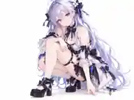

# 全身 08 · 侧身下蹲／单手扶膝 — 通用 Pose 视觉参考

> 本图片仅为 **用户审核通过的姿势、镜头、构图视觉参考**，不是 MMD / VPD 动作文件，也不是 AniForge Blender 渲染器的实际输出。图中的人物、发型、服装、鞋靴仅为示意；不能绑定角色骨骼坐标、服装材质或配饰。

## 已确认规格

| 项目 | 设计 |
| --- | --- |
| 组别/序号 | **全身 08**，区别于全身 07「鸭子坐」 |
| Pose | **侧身自然下蹲**，双腿屈曲形成高低错落层次，一侧膝盖自然较高 |
| 主动作手 | **单手轻扶较高的膝盖**，手指自然弯曲、不过分用力 |
| 另一只手 | **自然向身体侧前方垂放**，靠近地面但不强制以手掌撑地 |
| 双腿与脚 | 一只脚稳定贴地，另一腿根据鞋型与骨架比例屈曲/调整脚跟；腿部轮廓、鞋靴均清晰可辨 |
| 身体 | 轻微前倾，肩膀放松，不刻意扭腰、不夸张拱背 |
| 头部和表情 | 头部自然转向镜头，**俏皮但柔和的浅笑**，眼神看镜头 |
| 镜头 | 左前或右前 **约 45°**；略高位、轻微俯视 **5°–10°**，但避免高俯拍使腿过度压缩 |
| 画幅 | **4:3 横屏**；人物下蹲时的横向跨度显著增大 |
| 背景 | **纯白 #FFFFFF**，均匀柔和照明，不添加文字、道具和其他人物 |
| 构图 | 头顶、后发、袖子、臀侧衣装、双膝、双脚、鞋底/鞋跟及裙摆均完整保留；主体略偏画面中下部，优先清楚展示**大腿—小腿—鞋靴**关系 |
| 输出 | 仅输出 **1 张**，左/右镜像仅用于选择适配方向 |

## 与全身 07 鸭子坐的区分

- **07：W 坐** — 臀部接近地面，双膝靠拢、小腿向身体两边折叠，双手自然放在膝前；较为稳定、端庄、对称的坐姿。
- **08：侧身下蹲** — 重心由屈曲双腿支撑，**一膝较高、一手轻扶该膝、另一手自然下垂**；带有侧向动态，展示鞋子和膝部配件的不同方向。
- 二者都可以用 **4:3 横屏**，但不能复用完全相同的腿部或双手位置。

## 面向多款 MMD 模型的通用要求

1. **骨架与尺寸自适应（实现目标）**：根据髋、膝、踝、脚掌、肩、肘与腕部骨骼长度、轴向和关节范围制定下蹲姿势，不能直接使用示例人物的绝对关节旋转。
2. **蹲姿的稳定接地**：支撑脚尽量完整贴地；对于厚底鞋、高跟鞋、长靴可以降低下蹲幅度/改变脚跟高度，使鞋底和关节不严重陷地或穿模。
3. **腿、裙摆与附属物兼容**：裙子、披风、长发、武器、腰侧挂饰等均保留模型原有形态；对复杂裙装允许更浅的下蹲或人工修正，不以修改衣装来匹配参考图。
4. **扶膝手部目标**：手掌轻搭高位膝盖，不强制抓握、不陷入腿部或服装；另一手保持轻松低垂，可以靠近地面但不依赖手掌撑地。
5. **适用性回退**：若骨架限制或衣装穿模使原下蹲不可行，应降低蹲姿深度或回退为较高的侧蹲，并如实记录实际姿态。**不声称插件目前已有自动物理、碰撞修复或通用 IK。**
6. **动态取景（设计目标）**：姿态最终应用后，根据头饰、头发、鞋尖、鞋跟、裙摆、手掌的投影边界调节相机距离/正交尺度；重点避免腿与鞋被截断。
7. **表情映射**：优先采用模型现有的自然笑容形态键，缺失时回退中性表情，记录实际应用结果。

## 与站姿组的区别

- 全身 05：站立比心，2:3 竖屏。
- 全身 06：侧身交错站姿、一手扶腰，2:3 竖屏。
- 全身 07：鸭子坐、双手膝前，4:3 横屏。
- **全身 08：侧身下蹲、单手轻扶膝、另一手自然下垂，4:3 横屏。**

## 本 PR 的范围

本次**仅提交文字和已确认的单张参考图**，不修改当前 AniForge 的 Blender 渲染代码、全身镜头数量或动作实现。全身 09、10 等镜头以及进一步的衣装细节补充方案尚待逐张确定后再提交。
