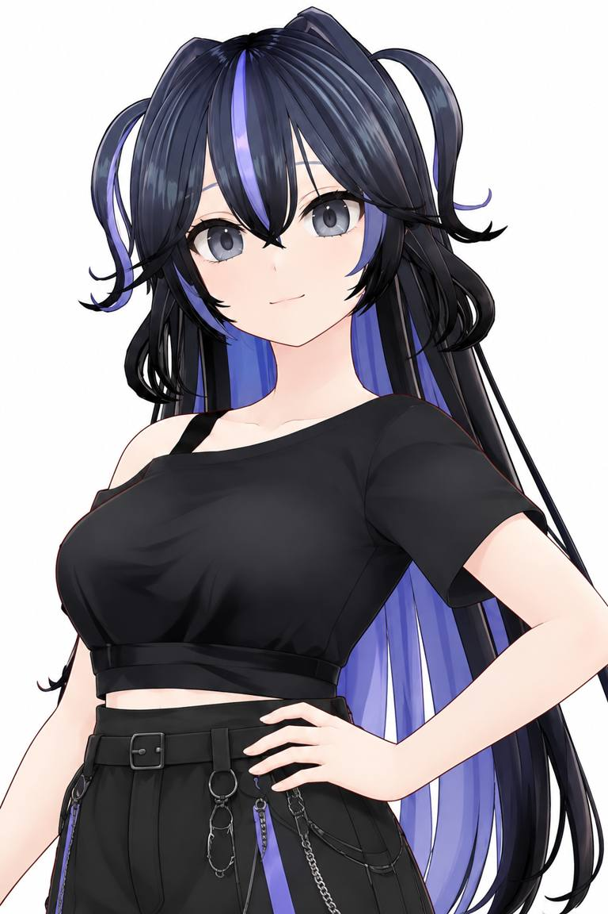

# 半身 05 · 单手叉腰 / 自信浅笑 — 通用 Pose 参考

> 本图为**视觉参考**，不是原始 MMD / VPD 姿势文件，也不是特定游戏模型的兼容性证明。AniForge 应实现适配不同角色、体型、骨架和服装的**通用 Pose 模板**，不可将图中服装、发型或人物造型写死。

## 已确认的镜头规格

| 项目 | 设计 |
| --- | --- |
| 分组 / 序号 | 半身 / 05（0.8.2 已接入当前半身 9 张方案；未来 12 张方案也保留此位置） |
| Pose | 单手叉腰，另一手自然放松；支持左右镜像 |
| 表情 | 自信浅笑：双眼自然睁开，嘴角轻微上扬，闭嘴且不过度夸张 |
| 镜头水平角 | 从角色左前或右前 **30°**；左右按模型和 Pose 的最终可见度选择 |
| 相机 | 透视，建议 75 mm 中焦感，机位基本平视，俯仰与滚转默认 0° |
| 画幅 / 背景 | **3:4 竖幅，纯白 #FFFFFF** |
| 构图 | 从头顶留白到大腿上部，确保叉腰手、手肘、腰部与发饰完整入镜 |
| 头部 | 轻微转向镜头约 10°–15°；视线看向镜头，不要夸张仰头 |

## 通用骨架与服装适配原则

1. **目标点由角色比例驱动：** 按骨架和实际变形后的身体位置推算肩、肘、腕、腰的目标，避免固定使用某个角色的关节坐标或绝对长度。
2. **左右镜像可选：** 同一 Pose 支持左右手叉腰；从两侧约 30° 的候选相机中选择主体可见度更高的一侧。最终只输出 **1 张**。
3. **避免穿模和遮挡：** 手掌贴近腰侧但不得穿入身体/服装；手指自然弯曲，手肘不要压住袖子。对于宽袖、披风、佩剑、长发、裙装和大饰物，应支持手动修正/回退，不声称自动无穿模。
4. **构图依据最终姿势：** 从头饰、发丝、肩、袖、叉腰手腕和手肘共同求取取景边界，按比例留边；不得因角色身高、头身比、肩宽变化而把重要部位截掉。
5. **表情可回退：** 优先映射 MMD 可用的微笑/嘴角形态键；不存在时使用自然表情，并真实记录映射结果。
6. **独立动作：** 这是半身特色照，与半身 01–04 统一自然站姿四视图不同；另外 7 张特色照尚待逐张确认。

## 当前实现与范围

此文档最初由 PR #3 记录视觉方案。0.8.2 已将单手叉腰模板接入当前半身05，采用按骨架比例及腰部衣服表面计算的手腕目标、掌心/手指朝向和静态避让，支持手动选择左右镜像及偏移。相机随用户所选镜像切换至对应30°，尚未实现自动判断左右遮挡后选优。

对六款本地模型执行了左右镜像的无出图手/躯干衣物三角面交叉及构图检查；锁暝另有正/侧/背三张画面检查。未检出表面交叉不等于所有服饰无穿模或手掌完全贴合，其他模型仍需逐个做视觉验收。全程不使用衣服物理。

0.8.3 继续修正了过度张开的拇指、笔直的指节和悬空的掌面。除了表面交叉，还检查指尖/掌心的贴合距离、实际拇指曲度及腕部弯折。最新本地场景保存半身05的30°预览相机，渲染检查使用正/侧/背。手部评估仍需看图，数值门限不能替代美术验收。

半身新的计划是 **4 张标准四视图 + 8 张特色半身照 = 12 张**；只有第 05 张已确认，其他动作、表情和镜头需继续讨论。落实代码及数量调整应另行检查和测试。
