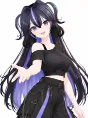

# 半身 08 · 单手邀请 / 侧前方展开手掌 — 通用 Pose 参考

> 这张图仅作为 **Pose、表情、镜头构图** 的视觉参考，不是 MMD/VPD 动作资产，也不是任何单一游戏角色的专用模板。图中发型、服装和人物特征不得被写入通用动作的实现。

## 已确认的动作设计

| 项目 | 规格 |
| --- | --- |
| 镜头序号 | **半身 08**；半身规划为 01–04 标准四视图 + 05–12 八张特色动作 |
| Pose | **单手向侧前方展开，掌心向上**，像自然邀请观众；另一只手在身体侧边自然放松 |
| 表情 | **友好微笑**：双眼自然睁开并看镜头，嘴角上扬，允许轻微张嘴但不强制 |
| 身体姿态 | 上半身轻微侧转、肩膀放松，避免强扭腰背；伸出的手臂和身体有清晰的空隙 |
| 头部与视线 | 头自然转回面向相机，视线与镜头接触；允许细微歪头，但不明显仰头或俯视 |
| 相机方位 | **左前或右前 45°**，左右依据实际模型与动作镜像选择，机位基本平视 |
| 相机与投影 | 透视中焦建议 **70–85 mm**，俯仰、画面滚转默认 0°；避免让前伸手掌因近距透视变形过大 |
| 画幅 | **3:4 竖幅** |
| 背景 | **纯白 #FFFFFF** |
| 构图范围 | 头顶略留白至大腿上部，完整保留头饰、伸出手掌的指尖、另一只手及腰部服装；必要时缩小主体保证手势不出框 |
| 输出策略 | 左右镜像属于备选方向，**最终只输出一张** |

## 面向不同 MMD 模型的通用适配要求

1. **动作由目标关系定义，而非固定坐标：** 以当前模型的肩、肘、腕、手掌和腰部位置计算目标，单手向侧前方自然伸展，手掌旋至朝上；不复制参考人物的绝对坐标和骨骼名称。
2. **支持左右镜像：** 左手与右手均可承担邀请动作。可将候选视角镜像，选择手部无遮挡、衣服显示更完整的一侧；没有自动可见度评估时允许用户手工指定。
3. **控制手臂前伸幅度：** 与半身 06「向镜头比耶」不同，08 侧向展开、手指自然张开，前伸深度适中。避免掌心覆盖眼睛、脸颊或胸前核心装饰。
4. **适应宽袖、披风、饰品和手套：** 手肘和袖口与躯干之间需留空间，避免穿模；对于特殊服饰允许动作目标偏移及手动调整，不能承诺目前已有自动碰撞修复。
5. **构图动态求边界：** 姿势应用后检查头发、肩、肘、伸出手、另一只手和腰部的投影范围，动态调整相机距离，以确保整个动作都进入画面。
6. **表情兼容回退：** 根据角色自身 MMD 形态键选择自然友好笑容；不支持张嘴表情时使用闭嘴微笑。标签与 manifest 必须反映实际生效的姿势与表情，而不是参考图的视觉结果。

## 与已确定半身动作的差异

| 编号 | Pose | 表情 | 镜头 |
| --- | --- | --- | --- |
| 05 | 单手叉腰 | 自信浅笑 | 侧前方 ±30° |
| 06 | **单手向镜头前伸 V 手势** | 开心笑脸 | 侧前方 ±15° |
| 07 | 双手腰腹前低位轻交叠 | 温柔浅笑 | 正面 0° |
| **08** | **单手向侧前方展开、掌心朝上** | **友好微笑** | **侧前方 ±45°** |

## 本 PR 的范围

本次**只增加说明文档和姿势参考图**，不会修改现有 Blender 插件的半身拍摄数量或渲染行为，也不代表已实现骨架通用自适应、自动穿模修复或镜头自动选优。全部半身 12 张计划确认后，再统一实施和验证。
