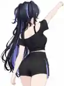

# 半身 11 · 背向单臂斜上举 — 通用 Pose 设计参考

> **此图片仅为 Pose 的视觉参考**，不是 MMD/VPD 姿势文件或 AniForge 自动渲染的实测图。示例角色、服装和发型不应被写死在插件中，也不能据此要求所有角色露背或调整原有服装。

## 已确认的设计

| 项目 | 规格 |
| --- | --- |
| 镜头编号 | 半身 11（计划中的四视图 + 八张特色半身照之一） |
| Pose | **背向镜头，单臂向侧上方斜举**，另一只手自然下垂 |
| 主动手臂 | 上臂相对躯干向侧上方抬起约 **70°–85°**，手肘略弯，手指自然放松 |
| 身体 | 以自然背向姿态为主，不扭腰、不后仰 |
| 头部 | 与身体朝向一致，**不回眸**，不刻意转脸看相机 |
| 表情 | 自然平静；背面不可见时不强求特殊表情 |
| 相机 | 偏后约 **160°**，可在左后/右后镜像选择；基本平视、俯仰和画面滚转默认 0° |
| 画幅 | **3:4 竖幅** |
| 背景 | **纯白 #FFFFFF** |
| 构图 | 从头顶到大腿上部附近，要求头饰、举起的手臂及指尖、肩背、后腰和自然下垂的手完整入镜 |
| 正式输出 | 左右镜像仅作为候选，**最终只保留一张** |

## 这张镜头需要补充的训练信息

- **肩背结构与后衣片**：展示不同手臂状态下的后领、肩胛区域、背饰及后腰连接。
- **袖子背面与内侧**：让袖口、腋下区域和衣服侧缝从其他半身镜头无法覆盖的角度显现。
- **上肢姿态变化**：与自然站姿的标准背面（半身 04）形成明显区别。
- **避免与半身 10 重复**：10 是侧后 135° 回眸、手抬至肩侧；11 是偏后 160°、**单臂斜上举且完全不回眸**，背部结构为主角。

## 通用 MMD 骨架和服装适配约束

1. **按照模型比例定位**：基于骨架肩/上臂/肘/腕的长度与局部轴向构造动作目标，不复制任何特定模型的绝对坐标或骨骼名称。
2. **允许左右镜像**：选择举左手或举右手、左后或右后的候选组合，优先保证背饰、肩背与袖子内侧可见；没有自动可见度评估时允许用户手动指定。
3. **不要为了露背而修改衣物**：无袖、长袖、披肩、披风和厚重肩甲都沿用原始服装；仅记录原有服饰在动作中的真实形态。
4. **长发保持原始造型**：默认不剪裁、不删除、不强行移动发束；具有可控发骨且用户允许时，可将“背饰优先取景”列为未来可选功能，当前不视为已实现。
5. **避免明显穿模**：举臂动作须检查宽袖、发束、肩饰、披风及武器挂件；若发生穿模，应保守降低抬手幅度或允许手动微调。
6. **动态裁切仅为实现目标**：由最终姿态的头顶、指尖、双肘、背饰、下垂的手及后腰边界计算安全取景；不声称目前已有自动可见度优化或碰撞修复。
7. **表情以实际应用结果为准**：面部不可见时不为满足标签强行改变表情；记录实际成功映射的形态键。

## 半身背部镜头之间的分工

| 编号 | 镜头目标 | 特征 |
| --- | --- | --- |
| 04 | 180° 标准背面 | 自然站姿，原始背部与后发型 |
| 10 | 135° 侧后回眸 | 单手轻抬至肩侧，展示斜侧肩背及表情 |
| **11** | **160° 背向单臂斜上举** | **肩背/袖子内侧/腋下/后腰，不回眸** |
| 12 | 180° 动态背部 | 尚未最终确定，可与 04 区分为双臂低幅度展开 |

## 本 PR 范围

仅新增**设计文档和参考图**，不更改插件的当前拍摄数量、Pose 编排、骨架 IK 或渲染代码。未来计划半身 12 张（4 张标准四视图 + 8 张不同动作），需在全部镜头确定后统一实施和进行 Blender/MMD 模型测试。
