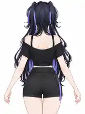

# 半身 12 · 正后方双臂自然轻展（轻度 A-Pose）— 通用 Pose 参考

> 本图为**已确认的视觉设计参考**，不是可直接导入的 MMD/VPD 动作文件，也不是 AniForge 的 Blender 真实渲染结果。图中人物、发型、衣物样式不属于通用动作的一部分；模型原有服装不得为了模仿示例而修改或移除。

## 已确认的规格

| 项目 | 规格 |
| --- | --- |
| 镜头编号 | **半身 12**（规划中的 4 张标准半身四视图 + 8 张动作半身照的最后一张） |
| 动作 | **正后方站立，双臂自然向两侧轻展**；形成轻度 A-Pose，不是 T-Pose |
| 肩 / 手臂 | 双臂离开身体侧面约 **30°–40°**，双肩下沉、不过度外展 |
| 手肘 / 手指 | 肘部自然微弯，手腕放松，五指自然展开、不握拳 |
| 躯干 | 正直背向镜头、不回眸、不扭腰、不夸张后仰 |
| 头部 / 表情 | 头部随身体朝前（镜头看见后脑），表情采用**中性**即可 |
| 镜头 | **正后 180°、平视**，俯仰 0°、滚转 0°；透视中焦可从 70–85 mm 起步 |
| 构图 | **3:4 竖幅**；头顶少量留白到大腿上部附近，双手指尖、两侧手肘、后领、背饰与后腰尽量完整入镜 |
| 背景 | **纯白 #FFFFFF** |
| 输出数量 | 固定输出一张；非必要不增拍左右镜像 |

## 目标：补充完整背面服装结构

1. **后领 / 肩背：** 自然呈现衣领背面、左右肩连接、肩部配饰与服装背片。
2. **双侧袖子：** 两臂稍离开身体，减少袖子与腰侧的重叠，更容易看到袖子背面、袖口与腋下的服装结构。
3. **后腰 / 下装上沿：** 展示腰带、蝴蝶结、链条、系带和衣摆等实际模型存在的背面装饰。
4. **发型 / 背饰的关系：** 原样保留后发型和现有背饰遮挡关系；**不强制掀发、删发、去披风或改变服装**。

## 与半身其他后部镜头的区别

| 编号 | 主要动作与方位 | 数据集作用 |
| --- | --- | --- |
| **04** | 正后 180°，标准自然站姿，双臂下垂 | 原始、静态背部基准 |
| **10** | 侧后约 135°，回眸 + 单手抬至肩侧 | 肩背侧面和回眸表现 |
| **11** | 偏后约 160°，**单臂斜上举且不回眸** | 举臂状态下的腋下、袖里与肩背 |
| **12** | **正后 180°、双臂低幅度自然轻展** | **两侧对称的完整背片、袖子和后腰** |

## 通用 MMD 骨架适配与审查

- **按骨架计算姿势：** 由肩、肘、腕部骨骼的相对位置和局部旋转轴来求取动作，不把示例人物的绝对坐标或骨骼名称写死；可按模型体型调整张臂幅度。
- **宽袖、披风、甲片及背饰兼容：** 保持角色原有服装与材质，在可用骨骼约束内减少严重穿模；必要时提供手动调整，不能宣称已有完备自动碰撞处理。
- **长发角色：** 默认保留原始发型。若未来增加背饰优先可见性模式，须由用户启用，并在有可用发束骨骼时谨慎调整，渲染后恢复原状态。
- **动态取景为后续实现目标：** 应依据最终姿势下头饰、头发、指尖、衣袖、后腰及披风在画面中的范围调节镜头距离，避免左右手被裁切。
- **验收应覆盖不同服装：** 短袖、无袖、宽袖、披风、长发、短发及含后背装饰的模型，确认动作自然、原有衣物不消失、白底输出正常。

## 实施范围

本 PR 仅提交**这份设计文档和配套的单张图片**，不更改当前 AniForge 的正式半身镜头数量、Pose 生成代码、Blender 渲染逻辑或模型自动适配能力。半身组完整规划为 **12 张（四视图 4 张 + 不重复特色动作 8 张）**；待计划统一审查后再实施并测试。
